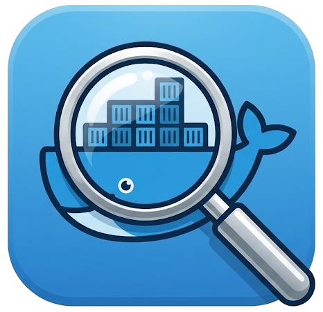

<div align="center">



# Docmon

**A terminal UI, web dashboard, REST API, and MCP server for your Docker machine.**

Docmon puts containers, live metrics, image freshness, and day-to-day operations
one screen away on Windows, Linux, and macOS. Use the local TUI without
authentication, or the authenticated React dashboard, REST API, and MCP tools
for remote operators and agents.

[](LICENSE.md)

**v0.1.1 — Alpha.** This is an early release under active development; features,
behavior, and APIs are subject to change.

</div>

## Capabilities

Docmon provides these interfaces to a Docker machine:

| Interface | Capabilities | Authentication |
| --- | --- | --- |
| Local terminal UI | Keyboard-driven container, image, Compose, metrics, events, and housekeeping screens on Windows, Linux, and macOS | No token; connects only to the local Docker socket or named pipe |
| Remote terminal UI | Docker operations through a Docmon server, including client-side file transfers and interactive shells | `--server <url>` with `--token <token>` or `DOCMON_BEARER_TOKEN` |
| Web dashboard | React console for monitoring, management, charts, request inspection, and API exploration | Bearer-token login |
| REST API and MCP | Programmatic Docker monitoring and control for scripts, integrations, and agents | Bearer token on every management request |

### Containers

- List running and stopped containers with names, IDs, images, states, health,
  status, creation times, ports, and Compose associations.
- Inspect command, restart policy, environment variables, mounts, networks,
  labels, published ports, and creation/start times.
- Start, stop, restart, kill, pause, unpause, and remove containers, with optional
  forced removal through the API/dashboard.
- Read recent container logs. The REST log reader supports a configurable tail
  of 1 through 10,000 lines.
- Execute commands with explicit executable/argument arrays, captured output,
  and exit codes.
- Open interactive shells: the local TUI uses the Docker CLI; the browser and
  remote TUI use an authenticated WebSocket connection to Docker exec.
- Pull a container's image and apply it to its Compose service. For standalone
  containers, this action pulls the image; recreating the container is a
  separate step, because restarting preserves its original image.

### Images and registries

- List local images with repository, primary tag, all available tags, image ID,
  digests, creation time, size, and update status.
- Identify untagged images explicitly and retain their IDs for inspection and
  removal; named repositories sort ahead of missing repository values in the
  dashboard.
- Pull a new image by name/tag or digest, or pull the reference of an existing
  tagged image selected by ID.
- Compare local and registry digests to check for updates, with unknown,
  checking, current, update-available, and error states.
- Discover registry tags. Docker Hub is the implemented provider for registry
  update checks and tag discovery.
- Remove individual images, optionally force removal, and prune dangling images
  with the reclaimed byte count reported.

### Compose projects

- Discover projects and services from Docker Compose labels, including project
  configuration paths and running/service counts.
- Bring projects up or down, restart them, and pull their service images.
- Target a service when bringing a project up or applying a container update.
- Capture Compose command output and exit codes.

Discovery uses the Docker socket. Lifecycle operations also require the original
Compose files and referenced dependencies to be accessible to the backend at
matching host paths. See [Compose project access](docker/README.md#compose-project-access).

### File transfers

- Copy files and directories into and out of containers using Docker archives.
- Use filesystem paths with the local TUI or the API's copy-in/copy-out operations.
  API filesystem paths refer to the backend's filesystem, including its mounts
  when the backend runs in Docker.
- Upload tar archives from the browser and download container files/directories
  as tar archives, without first staging them on the backend filesystem.
- Transfer files from the remote TUI's own machine through the archive endpoints.
- Support tar uploads up to 4 MiB. Larger server-side transfers can use the
  filesystem copy operations with appropriately mounted working directories.

### Metrics, events, and resource usage

- Collect live container CPU usage, memory usage/limits, network receive/transmit
  counters, and block-device read/write counters.
- View individual-container metrics or aggregate all Docker container workloads.
  The aggregate excludes unrelated host OS processes. Network and disk values
  are cumulative byte counters.
- Show live charts in the TUI and one full-width chart per metric tab in the web
  dashboard, with time/value axes and hover or keyboard-focus details.
- Read the latest metrics and recent metric history through REST and MCP.
- Monitor Docker daemon events with timestamps, event types, actions, and actors.
- Report Docker Engine version/OS, container and running counts, image and
  dangling-image counts, total image size, and volume count through the system
  usage API and TUI Tools screen.

The server retains up to 10,000 metric samples and 1,000 Docker events in memory.
These histories reset when it restarts.

### Request history and diagnostics

- Persist redacted request journals for 30 days, including method, path, status,
  duration, correlation ID, headers, and bounded request/response bodies.
- Browse, search, filter, sort, and page through request summaries, then open a
  full request inspector occupying 95% of the browser viewport.
- Retrieve retained request details even after an entry leaves the recent
  1,000-record memory cache.
- Chart successful and failed requests using complete time buckets, including
  empty intervals, computed from the retained journal.

| History timeframe | Bucket width | Number of buckets |
| --- | --- | --- |
| Last hour | 1 minute | 60 |
| Last day | 15 minutes | 96 |
| Last week | 2 hours | 84 |
| Last month, rolling 30 days | 8 hours | 90 |

Timeframe selection applies to the dashboard history table and chart. The API
also exposes windowed enumeration and bucket summaries. Request bodies are
bounded to 4,096 characters after redaction; see the [REST API conventions](REST_API.md#authentication-and-conventions)
for capture behavior and limits.

### Web dashboard

- Overview cards, recent request activity, Docker workload totals, containers
  needing attention, and quick navigation to management pages.
- Dedicated containers, images, Compose stacks, metrics, events, request history,
  API explorer, and server/settings pages.
- Compact tables with ascending/descending column sorting, global search,
  per-column filters, selectable columns, pagination, manual refresh, and automatic
  refresh every five seconds.
- Persist selected columns, page sizes, history timeframe, language, and theme.
- Row inspection dialogs, copy controls, operation confirmations, and context
  menus rendered above page content and kept within the viewport.
- OpenAPI-driven endpoint selection, path/query parameter inputs, JSON request
  editing, tar upload/download support, response/header inspection, and request
  copying in the API explorer.
- Navy & Silver light/dark themes, responsive layouts, project branding, and
  GitHub/Discord links in the topbar.
- Twelve languages: English, Spanish, Brazilian Portuguese, French, Italian,
  German, Simplified Chinese, Arabic, Russian, Malay, Hindi, and Japanese.
  Language selection works before and after login, with locale-aware formatting,
  Arabic RTL layout, and expansion/RTL test locales. See [internationalization](dashboard/I18N.md).
- Token storage scoped to the browser tab session, sign-out clearing, and
  automatic sign-out when the API rejects the token.

### REST, MCP, and integration tooling

- C# Watson 7 REST server at `/api/v1`, with typed requests/responses, bearer
  authentication, structured errors, and request correlation IDs.
- Live OpenAPI metadata at `/openapi.json`, interactive Swagger at `/swagger`,
  and checked-in [REST documentation](REST_API.md) and [OpenAPI snapshot](assets/openapi.json).
- A colocated Voltaic MCP server exposed through the authenticated `/mcp`
  gateway, with tools for container lifecycle, inspection, logs, exec, copies,
  image operations, Compose operations, metrics, events, system information,
  and request history. See the [MCP tool reference](MCP_API.md).
- Shared `EnumerationQuery`/`EnumerationResult<T>` collection contracts with
  search, scalar-field filters, sorting, container/time filters, result counts,
  and continuation-token pagination. The dashboard and remote TUI follow pages
  automatically.
- Public Docker readiness checks at `/health`; management APIs and MCP require
  authentication. The token grants machine-wide Docker access.
- Root [Postman collection](Docmon.postman_collection.json), a separate
  [read-only smoke collection](Docmon.read-only.postman_collection.json), and a
  generator that keeps API inventories, documentation, and collections aligned
  with live route metadata.

Interactive WebSocket terminals and binary archive transfer are REST transports;
MCP agents use exec and filesystem copy tools for those tasks. Web/remote terminal
resize negotiation is not implemented yet.

### Deployment and local tooling

- Separate named backend/dashboard images and a two-service Docker Compose
  deployment with health checks, configurable ports/interface bindings, Docker
  socket access, and a persistent request-history volume.
- A working `docker/.env` with the default token `docmonadmin` and published
  interfaces bound to `0.0.0.0`.
- Dashboard-origin proxying of REST, Swagger/OpenAPI, WebSocket terminals, and MCP.
- Shell and Windows batch build helpers for server, dashboard, or both: build
  Linux amd64/arm64 images, push the requested tag plus `latest`, and refresh the native
  local image copy.
- `docker/update.sh` and `docker/update.bat` to pull the configured images and
  recreate the services while preserving the named data volume.
- `go.sh`/`go.bat`, `run-tui.sh`/`run-tui.bat`, and
  `run-server.sh`/`run-server.bat` source launchers, with .NET 8/10 selection and
  application argument forwarding.
- .NET global-tool packaging, Windows install/reinstall/remove helpers, shared
  backend test suites, frontend/browser tests, and GitHub Actions checks.

## Web dashboard and agent access

### Running in Docker

The container monitors Docker through the mounted /var/run/docker.sock.

Compose mounts the host socket into the backend. Docmon sends Docker Engine API
requests through that socket to the host's Docker daemon for container state,
resource statistics, logs, exec, images, and lifecycle operations. The dashboard's
“All Docker workloads” view sums container metrics; it does not measure unrelated
host processes or provide host-wide OS monitoring. With Docker Desktop, the daemon
and Linux containers run inside Docker Desktop's Linux VM.

```bash
# docker/.env is included; default bearer token: docmonadmin
docker compose -f docker/compose.yaml up -d
```

Compose pulls `jchristn77/docmon-server:v0.1.0` and `jchristn77/docmon-dashboard:v0.1.0`. To build and publish both architectures, run `./build-all.sh v0.1.0` (or `build-all.bat v0.1.0`); see [image build instructions](docker/README.md#build-and-publish-images).

Open **http://127.0.0.1:8088** and enter the configured token. The dashboard
covers containers, images, Compose stacks, live metrics/history, Docker events,
request history, logs, commands, interactive shells, host and browser file
transfers, registry tags, and image update checks. It includes light/dark themes,
locale persistence, sortable/filterable tables, and a live OpenAPI explorer.

- REST: `http://127.0.0.1:8080/api/v1` or the dashboard origin `/api/v1`.
- Swagger: `/swagger`; OpenAPI metadata: `/openapi.json`.
- MCP: `/mcp` on the same public API/dashboard origin, powered by Voltaic.
- Every control/read API and MCP request requires `Authorization: Bearer <token>`.
  Health and OpenAPI/Swagger documentation are anonymous.
- The token grants full control of the Docker machine. Use HTTPS for remote access.

See [docker/README.md](docker/README.md) for networking, ports, token rotation,
Compose file mounts, and persistence. The stack runs only the backend and dashboard.
[REST_API.md](REST_API.md), [MCP_API.md](MCP_API.md), and the
[root Postman collection](Docmon.postman_collection.json) document the full agent surface.

### Run from source

Requires the .NET 8 or .NET 10 SDK and Node.js 22 or newer for the dashboard.
The commands below use .NET 10:

```bash
export DOCMON_BEARER_TOKEN="$(openssl rand -hex 32)"
dotnet run --project src/Docmon.Server -f net10.0
# In another terminal:
cd dashboard
npm ci
npm run dev
```

The server binds `127.0.0.1:8080` by default and the dashboard dev server uses
`http://127.0.0.1:5173`. Configure `DOCMON_HOST`, `DOCMON_PORT`,
`DOCMON_MCP_PORT`, `DOCKER_HOST`, `DOCMON_DATA_DIRECTORY`, and optionally
`DOCMON_ALLOWED_ORIGIN` for direct cross-origin clients. Docker and MCP connections
are created once and shared. Docker may recover after a daemon restart without
restarting Docmon. JSON REST operations have a 30-minute timeout.

### Local and remote TUI

Running `docmon` uses the local Docker socket or Windows named pipe, with no
bearer token and no dependency on the web server. It deliberately ignores
`DOCKER_HOST` in local TUI mode. Opt in to remote access explicitly:

```bash
docmon --server https://your-machine --token "your-remote-machine-token"
```

The `--token` option overrides `DOCMON_BEARER_TOKEN`. You can still set that
environment variable and omit `--token`. Local TUI mode needs no token.

Remote mode implements the same service interfaces through the authenticated
API, including archive transfers and interactive WebSocket shells. Transfers use
the TUI client's filesystem. Remote image pulls and exec report bounded output
when the operation completes; monitoring polls the API every two seconds.
Terminal resize negotiation is not implemented yet. Compose operations run on the
server and resolve the server's discovered compose files.

## Screens

Docmon is organized into sections you move between with `Tab` / `Shift+Tab` or
the number keys `1`–`6`:

| # | Screen | What you get |
|---|---|---|
| 1 | **Containers** | The master table plus a live detail pane with inline CPU/memory charts |
| 2 | **Stacks** | Compose projects, their services, and stack-level actions |
| 3 | **Metrics** | Full-size CPU / memory / network / disk charts, overall or per container |
| 4 | **Images** | Local images, registry digests, and update status |
| 5 | **Events** | A live stream of Docker daemon events |
| 6 | **Tools** | Engine/OS information, resource counts, image storage, and dangling-image pruning |

## Requirements

- The **.NET 8 or .NET 10 SDK** (or the matching runtime, if you install the
  packaged tool). See [Installing the .NET SDK](#installing-the-net-sdk) below.
- A reachable **Docker daemon** on the same host:
  - Windows: the `npipe://./pipe/docker_engine` named pipe (Docker Desktop).
  - Linux/macOS: the `unix:///var/run/docker.sock` socket. The backend honors `DOCKER_HOST` to
    override.
- The `docker` CLI and Compose plugin on `PATH` for Compose lifecycle operations
  and local interactive shells/TTY exec. The backend Docker image includes them.

Docmon runs in any modern terminal. For the best rendering, use a terminal with
truecolor and a font that includes box-drawing and block glyphs (Windows
Terminal, iTerm2, most Linux terminals).

## Install

### Installing the .NET SDK

Docmon needs the **.NET 8 or .NET 10 SDK**. Download it from Microsoft:

- All versions: <https://dotnet.microsoft.com/download>
- .NET 10 SDK: <https://dotnet.microsoft.com/download/dotnet/10.0>
- .NET 8 SDK: <https://dotnet.microsoft.com/download/dotnet/8.0>
- Linux, per-distro instructions: <https://learn.microsoft.com/dotnet/core/install/linux>

Quick install by platform:

```bash
# Windows (winget)
winget install Microsoft.DotNet.SDK.10

# macOS (Homebrew)
brew install --cask dotnet-sdk

# Linux (Microsoft install script; installs into ~/.dotnet)
curl -sSL https://dot.net/v1/dotnet-install.sh | bash -s -- --channel 10.0
```

Confirm it is on your `PATH`:

```bash
dotnet --version
```

### Installing Docmon

Docmon ships as a **.NET global tool** named `docmon`. Once installed you can run
`docmon` from any directory.

```bash
dotnet tool install --global Docmon
docmon
```

Global tools install under `~/.dotnet/tools`; if `docmon` is not found, add that
directory to your `PATH` (the tool installer prints the exact path to use).

Building and installing from source:

```bat
git clone https://github.com/jchristn/Docmon.git
cd Docmon
REM Windows convenience scripts (pack + install the 'docmon' command).
REM Both accept an optional target framework: net8.0 or net10.0.
install-tool.bat                 REM auto-selects net10.0 if a .NET 10 SDK is present, else net8.0
install-tool.bat net8.0          REM force .NET 8
reinstall-tool.bat net10.0       REM rebuild and replace an existing install
remove-tool.bat                  REM uninstall
```

The application is multi-targeted for **net8.0** and **net10.0**; the framework
argument selects which runtime the global tool is installed against.

On Linux/macOS the same thing by hand (pick a framework you have installed):

```bash
dotnet pack src/Docmon.App/Docmon.App.csproj -c Release -p:TargetFrameworks=net8.0 -o ./nupkg
dotnet tool install --global --add-source ./nupkg --framework net8.0 Docmon
```

## Usage

```
docmon                 # connect to the local Docker daemon and open the TUI
docmon --no-splash     # skip the startup splash screen
docmon --version       # print version and exit
docmon --help          # print usage and exit
docmon --server https://your-machine --token "your-token"  # remote TUI
```

Common keys once you're in:

```
Tab / Shift+Tab   move between panes            1..6   jump to a screen
↑ ↓ PgUp PgDn      navigate a table/pane         Home / End   first / last row
Enter              inspect selected              o      toggle metrics scope
s / x / l          shell / exec / logs           F1 / ? help
r S K p            restart / stop / kill / pause  u / U check updates / pull+apply
t                  transfer files                Ctrl+Q quit
```

## How it works

Docmon talks to Docker two ways. Most data and control goes through the Docker
Engine API using [Docker.DotNet](https://github.com/dotnet/Docker.DotNet):
listing, inspecting, stats streaming, lifecycle, image pulls, and archive-based
file transfer. Interactive work that needs a real terminal — opening a shell or
an `exec -it` session — shells out to the `docker` CLI, because a TUI pane can't
host a pseudo-terminal. For those, Docmon suspends its own UI, hands the terminal
to the child process, and restores the dashboard when you exit.

Web and remote-TUI terminals use an authenticated Watson WebSocket bridge to a
Docker exec connection with HTTP Upgrade.

The code is split into a `Docmon.Core` library (models, shared runtime, Docker
services, remote HTTP adapter, and registry abstraction), a `Docmon.Server`
Watson 7 API/Voltaic MCP host, a React `dashboard/`, and a `Docmon.App` executable
that hosts the
[TUIKit](https://www.nuget.org/packages/TUIKit/) interface. Update checks go
through an `IRegistryProvider` interface; Docker Hub ships first, and other
registries slot in behind the same interface.

## Dashboard and API conventions

The dashboard uses the Navy & Silver palette derived from the icon, compact navigation,
tabbed container/host-workload metrics with labeled interactive charts, sortable tables,
viewport-safe operation menus, a request inspector, and an OpenAPI endpoint selector.
See [dashboard internationalization](dashboard/I18N.md) for all twelve supported languages.
The host metrics view aggregates Docker container workloads, excluding other host processes.

Collection REST reads and MCP tools use `EnumerationQuery` and `EnumerationResult<T>`:
page through `objects` using `continuationToken` until `endOfResults` is true. This replaces
bare-array responses. Detail reads and actions retain their resource/result shapes.
The dashboard and remote TUI follow every page automatically. See [REST_API.md](REST_API.md)
for paging, ordering, filtering, and query-bound continuation tokens.

## Building

```bash
dotnet build src/Docmon.slnx -c Release
dotnet test  src/Docmon.slnx -c Release
```

The build treats warnings as errors and generates XML documentation.

## Testing

Tests are written once as [Touchstone](https://github.com/jchristn/touchstone)
descriptors in `src/Test.Shared` and run through any of three runners:

| Project          | Runner                                  | Command                                              |
|------------------|-----------------------------------------|------------------------------------------------------|
| `Test.Automated` | Touchstone console runner               | `dotnet run --project src/Test.Automated -f net10.0` |
| `Test.Xunit`     | xUnit (fact-style and per-case theory)  | `dotnet test src/Test.Xunit`                         |
| `Test.Nunit`     | NUnit (fact-style and per-case source)  | `dotnet test src/Test.Nunit`                         |

Add `-- --results results.json` to the console runner to export JSON results.

Most suites run offline (helpers, models, registry logic against an in-memory
HTTP handler, Docker payload mapping, argument validation, TUI state, and
off-screen rendering of the header, tabs, status bar, and screens through
TUIKit's testing surface). The
`Docker*` suites exercise a live daemon: they pull `alpine:3.20` if needed and
create uniquely named containers and compose projects labeled `io.docmon.test`,
which they always remove. They never touch existing containers or images, and
never prune. Those suites are skipped automatically when no daemon is
reachable, or explicitly with `DOCMON_TEST_SKIP_DOCKER=1`.

Source launchers are available for macOS/Linux and Windows:

```bash
./go.sh                         # alias for the local TUI
./run-tui.sh                    # build and run the TUI
./run-tui.sh net8.0 --no-splash  # choose a framework and forward app options
./run-server.sh                 # build and run the API/MCP server
```

Windows equivalents are `go.bat`, `run-tui.bat`, and `run-server.bat`.
All launchers work from any directory and default to .NET 10 when its SDK is
installed, otherwise .NET 8. Use `net8.0`, `net10.0`, or `--framework <version>`
to select explicitly. Server launchers preserve environment configuration and
use `docmonadmin` when `DOCMON_BEARER_TOKEN` is unset. Native server binding
still follows `DOCMON_HOST` (default `127.0.0.1`); Docker uses the included `.env`.

Request history offers last hour/day/week/month views, with respectively
60 one-minute, 96 fifteen-minute, 84 two-hour, and 90 eight-hour buckets.
Month means the rolling last 30 days. Charts use the retained journal, and
request details open in a dialog using 95% of the viewport.

## License

MIT — see [LICENSE.md](LICENSE.md). Copyright (c) 2026 Joel Christner.
